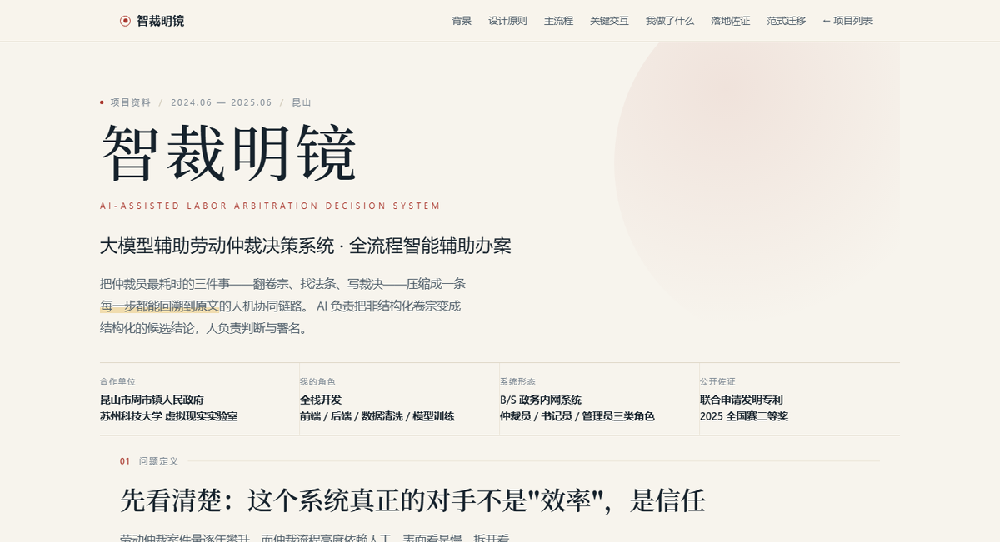
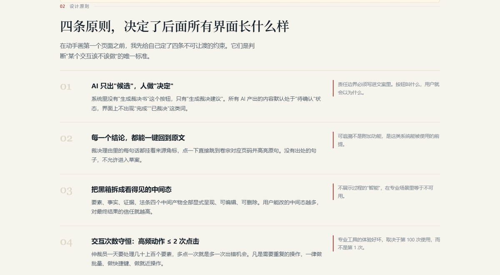
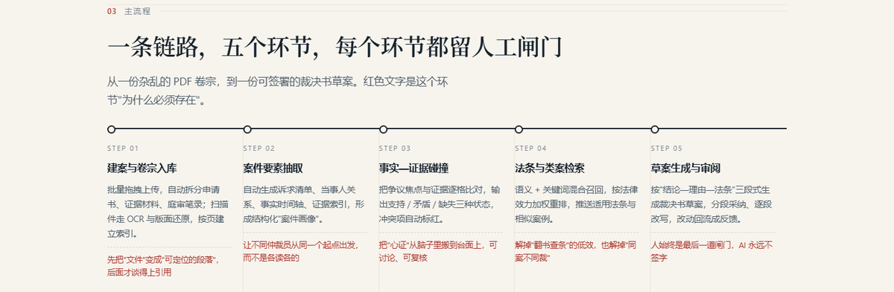
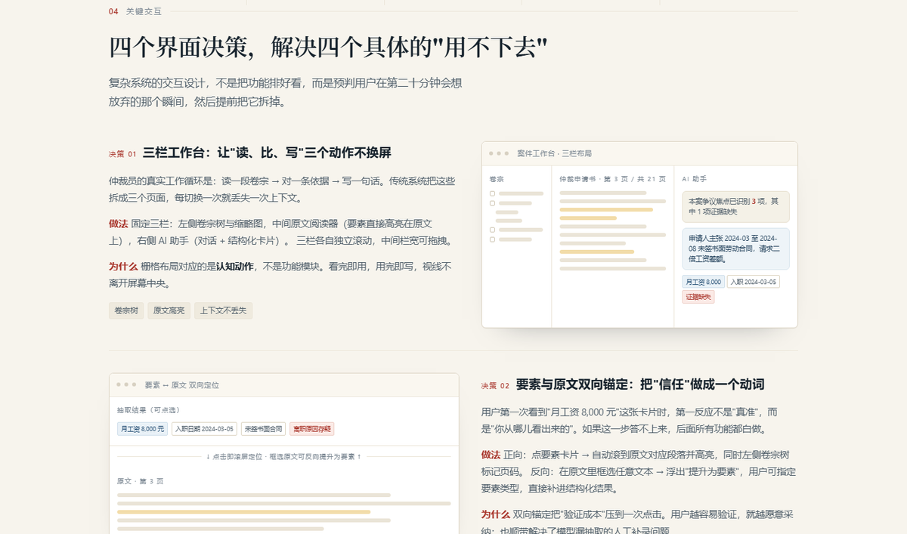
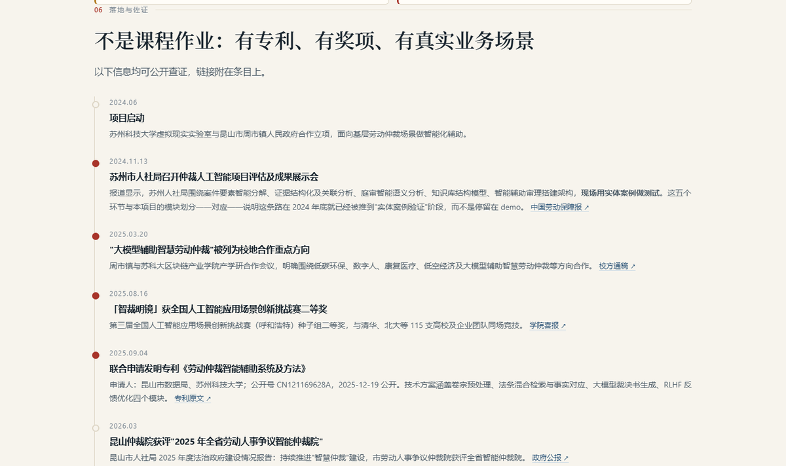
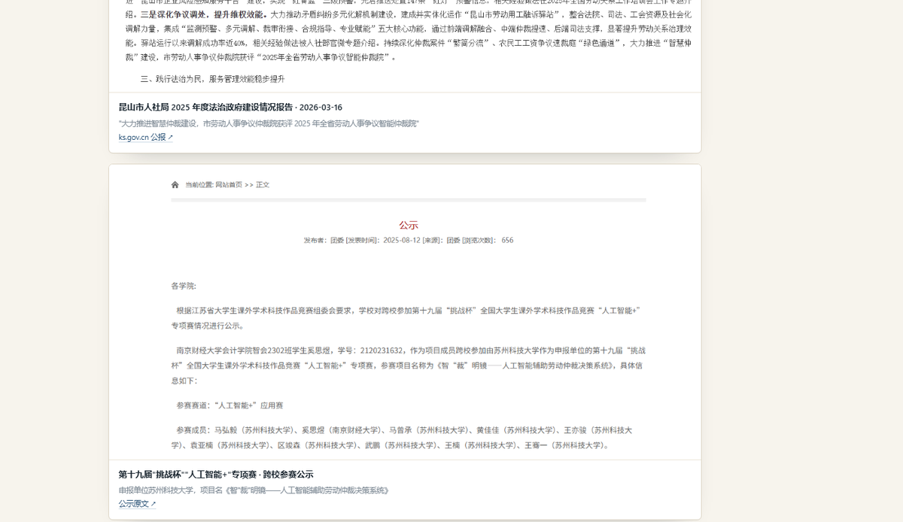

# 智裁明镜 · 大模型辅助劳动仲裁决策系统

> 把"翻卷宗、找法条、写裁决"压缩成一条每一步都能回溯到原文的人机协同链路。**AI 只出候选，人做决定。**

**[→ 在线浏览完整演示](https://myzhgjb.github.io/ai-arbitration/)**

`2024.06 — 2025.06` ｜ 昆山市周市镇人民政府 × 苏州科技大学虚拟现实实验室 ｜ 全栈开发（前端 / 后端 / 数据 / 模型）

---

## 四条设计原则

政务系统里，AI 错误的代价远高于多花十分钟。所以这套系统的目标不是"自动裁决"，而是让 AI 的每一步中间态都被人看见、被人否决。

## 五个环节，每个环节都留人工闸门

卷宗入库 → 案件要素抽取 → 事实证据碰撞 → 法条与类案检索 → 裁决书草案审阅。红色文字是这个环节"为什么必须存在"。

## 关键交互：让"读、比、写"三个动作不换屏

仲裁员的真实工作循环是：读一段卷宗 → 对一条依据 → 写一句话。三栏布局对应的是**认知动作**，不是功能模块。

## 公开佐证

不是课程作业：有专利、有奖项、有真实业务场景。

- 联合申请发明专利《劳动仲裁智能辅助系统及方法》（公开号 **CN121169628A**，昆山市数据局 + 苏州科技大学）
- 第三届全国人工智能应用场景创新挑战赛 · **智能司法场景赛 · 二等奖**
- 第十九届"挑战杯""人工智能+"专项赛参赛项目（申报单位：苏州科技大学）
- 相关地区仲裁院获评"**2025 年全省劳动人事争议智能仲裁院**"

> 说明：本人为项目开发成员，非专利发明人。

## 我做了什么

| 方向 | 内容 |
|---|---|
| 数据 | 卷宗 pdf / 扫描件 / Word 混合格式清洗、版面还原、要素 schema 设计、敏感字段脱敏 |
| 模型 | SFT 样本构建、结构化输出约束（结论—理由—法条三段式）、改写行为回收成偏好数据 |
| 后端 | 卷宗上传与异步解析、向量 + BM25 混合检索、问答编排与结果落库 |
| 前端 | 三栏工作台、要素高亮与双向定位、碰撞矩阵、草案分块审阅，长文档虚拟滚动 |

## 技术

`Java` `Spring Boot` `MyBatis-Plus` `MySQL` `Redis` `Vue` `向量检索 + BM25` `大模型结构化输出`

---

本仓库为项目结构与个人工作说明，界面部分为交互线框示意，非系统真实截图，不含任何真实案件数据。公开信源截图见 `证据截图/`。
